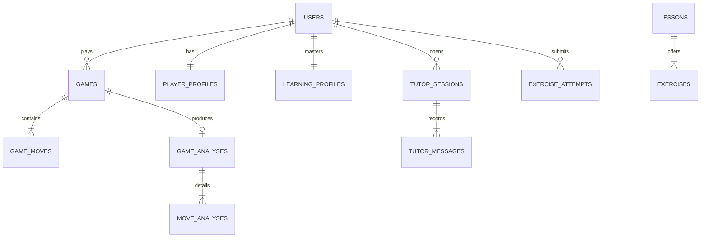

# Chess AI Tutor — System Architecture Document

## 1. Executive Summary & Vision
The **Chess AI Tutor** is a distributed, production-grade learning platform combining deterministic chess engine calculations with LLM-driven pedagogical intelligence.

### The Cardinal Rule
> **Stockfish is the single authority for chess calculations; the LLM is responsible solely for teaching, explanations, and coaching.**
>
> Under no circumstances does an LLM independently calculate legal moves, evaluate positions, or suggest the "best" move without validation from the chess engine.

---

## 2. Requirements & User Stories

### Epic 1: Interactive Play & Real-time Validation
- **US-1.1 (Move Validation & Execution)**: As a player, I want to make legal chess moves on an interactive board so that I can play against various bot personalities or practice positions.
  - *Acceptance Criteria*:
    - Moves validated server-side using `python-chess`.
    - Optimistic concurrency control (version header / counter) prevents duplicate or out-of-order move execution.
    - Idempotency key per move prevents double-submits on network jitter.
- **US-1.2 (Game State Lifecycle)**: As a player, I want game states (`CREATED`, `IN_PROGRESS`, `CHECK`, `CHECKMATE`, `STALEMATE`, `DRAW_BY_RULES`, `RESIGNED`) tracked accurately.

### Epic 2: Asynchronous Deep Game Analysis
- **US-2.1 (Full Game Analysis Request)**: As a player, I want to request a full-game post-mortem analysis without freezing the UI or blocking API threads.
  - *Acceptance Criteria*:
    - Job is queued via Redis-backed workers (Celery/Dramatiq).
    - Status transitions: `PENDING` -> `RUNNING` -> `COMPLETED` / `FAILED`.
    - Multi-worker pool limits concurrent Stockfish instances to prevent CPU starvation.
- **US-2.2 (Move Classification)**: Every move is evaluated by Stockfish and classified into standard categories: *Brilliant, Great, Best, Excellent, Good, Inaccuracy, Mistake, Blunder*.
- **US-2.3 (Weakness Detection)**: The system aggregates recurring blunders across tactical categories (e.g. Back Rank, Knight Forks, Pinning, Pawn Structure, Endgame King Activity) into the student's mastery profile.

### Epic 3: Conversational Pedagogical Tutor
- **US-3.1 (Context-Aware Coaching)**: As a player, I can ask the AI Tutor *"Why was move 23... Be6 a blunder?"* or *"What plan should I pursue here?"*.
  - *Acceptance Criteria*:
    - The LLM receives pre-computed FEN, evaluation diff, engine best continuation, and tactical tags.
    - The LLM employs Socratic questioning rather than just dumping moves.
    - LLM provider is swappable (OpenAI, Gemini, Anthropic, local/Ollama) via an Adapter interface.
    - Circuit breaker protects the app from external AI provider outages.

### Epic 4: Personalized Mastery & Curriculum
- **US-4.1 (Learning Profile & Skill Tree)**: Player skill ratings per tactical and strategic concept are updated after every analyzed game.
- **US-4.2 (Targeted Exercises)**: The system recommends specific exercises based on detected player weaknesses.

---

## 3. System Boundaries & C4 Context

### 3.1 Context Diagram
```mermaid
flowchart TD
    Player["Player (Browser / Web Client)"]
    
    subgraph System["Chess AI Tutor System"]
        Frontend["React + TypeScript SPA\n(Vite, Tailwind, Chessground)"]
        Backend["FastAPI API Gateway & App Services\n(Clean Architecture / DDD)"]
        Queue["Redis Task Broker & Cache"]
        Worker["Engine Analysis Workers\n(Stockfish UCI Pool)"]
        DB[("PostgreSQL\n(Relational Domain Data)")]
    end

    ExternalLLM["LLM Providers\n(Gemini / Anthropic / OpenAI)"] / OLLAMA 

    Player <-->|"HTTPS / WSS"| Frontend
    Frontend <-->|"REST / JSON & SSE"| Backend
    Backend <-->|"SQLAlchemy 2.0"| DB
    Backend <-->|"Enqueue Jobs & Pub/Sub"| Queue
    Queue <-->|"Consume Jobs"| Worker
    Worker <-->|"Stockfish IPC (stdin/stdout)"| Worker
    Worker <-->|"Persist Analysis"| DB
    Backend <-->|"Provider Adapter (with Circuit Breaker)"| ExternalLLM
```

---

## 4. Architectural Patterns & Engineering Guidelines

### 4.1 Clean Architecture / Hexagonal Ports & Adapters
```
┌────────────────────────────────────────────────────────┐
│ Presentation Layer (FastAPI Routers, Pydantic DTOs)     │
├────────────────────────────────────────────────────────┤
│ Application Layer (Use Cases, Commands, Queries, CQRS) │
├────────────────────────────────────────────────────────┤
│ Domain Layer (Entities, Value Objects, Domain Events)   │
│  - No external framework dependencies                  │
│  - Pure Python + python-chess rules                    │
├────────────────────────────────────────────────────────┤
│ Infrastructure Layer (Adapters)                        │
│  - PostgreSQL Repositories + Unit of Work              │
│  - Stockfish Engine Worker (UCI Protocol)              │
│  - LLM Provider Adapter (LangGraph / LangChain / SDK)  │
│  - Redis Cache & Distributed Locks                     │
└────────────────────────────────────────────────────────┘
```

### 4.2 Key Design Patterns Applied
| Pattern | Purpose & Implementation |
|---|---|
| **Repository Pattern** | Decouples domain entities from database ORM mappings (`GameRepository`, `AnalysisRepository`). |
| **Unit of Work** | Guarantees atomic transaction boundaries across multiple repositories and emits Outbox events on commit. |
| **Strategy Pattern** | Pluggable opponent logic: `HumanOpponentStrategy`, `StockfishBotStrategy(level)`, `TutorAssistedStrategy`. |
| **Factory Pattern** | Configures Stockfish UCI subprocesses with customized threads, hash size, and skill levels. |
| **Adapter Pattern** | Standardized `EnginePort` and `LLMPort` to swap providers without affecting business logic. |
| **State Pattern** | Models valid game transitions (`Active` -> `Check` -> `Checkmate` / `Drawn` / `Resigned`). |
| **Idempotency Pattern** | Move submission and analysis requests accept an `Idempotency-Key` header; cached in Redis to prevent replay attacks. |
| **Optimistic Concurrency** | Each game has a monotonically increasing `version`. Moves check `expected_version == current_version`. |
| **Circuit Breaker & Retry** | External LLM calls are wrapped with Tenacity backoff and circuit-breaking to protect against downstream rate limits or failures. |
| **Outbox Pattern** | Domain events are written into an `outbox` table within the same DB transaction as state updates, then dispatched asynchronously. |

---

## 5. Domain Model & Invariants



### Critical Invariants
1. **Move Legality Invariant**: A move cannot be committed to `game_moves` unless verified as legal by `python-chess` against the current board FEN.
2. **Move Sequence Integrity**: `move_number` and `color` must alternate strictly according to chess rules.
3. **Engine Isolation**: Analysis workers communicate with Stockfish via the UCI protocol over isolated IPC pipes. CPU cores and max execution time are bounded per move.
4. **Analysis Idempotency**: An analysis for `(game_id, version)` can only be computed once. Subsequent duplicate requests return the existing job or result.

---

## 6. Monorepo Directory Layout

```
Chess_AI/
├── .github/
│   └── workflows/
│       └── ci.yml               # CI Pipeline: Linting, Unit & Integration Tests
├── docs/
│   ├── architecture/            # Architecture & C4 documentation
│   └── adr/                     # Architectural Decision Records
├── backend/
│   ├── src/
│   │   └── chess_ai/
│   │       ├── domain/          # Core Domain (Entities, Enums, Value Objects, Ports)
│   │       ├── application/     # Use Cases & Application Services (CQRS)
│   │       ├── infrastructure/  # DB, UCI Stockfish, Redis, LLM adapters
│   │       ├── presentation/    # FastAPI routers, middleware, error handlers
│   │       └── config.py        # Typed application settings (pydantic-settings)
│   ├── tests/
│   │   ├── unit/
│   │   ├── integration/
│   │   └── conftest.py
│   ├── pyproject.toml           # uv / PEP 621 dependencies & tools
│   ├── ruff.toml                # Ruff linting & formatting standards
│   └── Dockerfile
├── frontend/
│   ├── src/
│   │   ├── components/          # Reusable UI components (Board, EvalBar, Chat)
│   │   ├── features/            # Feature modules (play, analysis, tutor, profile)
│   │   ├── services/            # Typed API client
│   │   ├── types/               # TypeScript domain interfaces
│   │   ├── App.tsx
│   │   └── main.tsx
│   ├── package.json
│   ├── tsconfig.json
│   ├── vite.config.ts
│   ├── tailwind.config.js
│   └── Dockerfile
├── docker-compose.yml           # Local dev orchestrator (DB, Redis, Backend, Frontend, Worker)
├── Makefile                     # Developer ergonomic shortcuts
└── README.md                    # Project overview & quickstart
```
